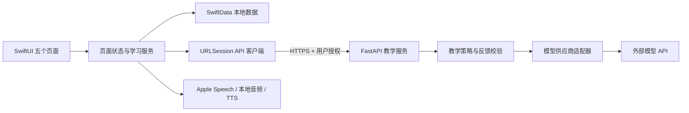

# LinguaMate AI：第一阶段需求与技术设计

状态：设计完成，待进入第二阶段。本文描述计划，不代表功能已实现。当前仓库只有初始 README，本阶段仅新增本文档，不生成应用代码、不接入付费服务。

已确认条件：用户有 iPhone，暂时没有 Mac；当前云环境为 Linux，有 Node.js、Python 和 Git，没有 Xcode 或 Swift。开发语言以中文为主，学习语言为英语和韩语。

## 1. 产品理解与边界

LinguaMate AI 是个人语言学习助手，核心闭环是：设定目标 → 完成表达或练习 → 获得可解释的反馈 → 保存错误与词汇 → 安排复习 → 用后续练习验证改善。

- 英语目标：IELTS Academic 7.0+、CET-6，以及独立的日常和学术交流能力。
- 韩语目标：TOPIK II 5–6 级，以及独立的日常交流能力。TOPIK 听力、阅读、写作与韩语口语单独记录。
- 学习记录是事实，能力判断是需要证据的推断。连续打卡、学习时长、词汇数量不换算为雅思分数或 TOPIK 等级。
- 首次评估先收集自报水平、已有考试成绩、学习时间与优先技能；未经验证的短测只能提供练习基线，不能认证语言等级。
- 中文解释优先；对话主要用目标语言。跨语言释义保留源语言与解释语言，不把同一个词在不同语言中的掌握状态合并。
- 自编练习、示例记录、AI 反馈、练习估分和官方成绩必须有不同标记。只有用户明确录入并标记来源的实际考试成绩才能进入“考试成绩”档案。

## 2. MVP 与后续范围

### 2.1 首版：完成一个可靠的文字学习闭环

| 模块 | MVP 必须实现 | 验收条件 |
| --- | --- | --- |
| 引导与档案 | 英韩分别选择自报水平、目标、每日总时长、优先技能；考试日期与历史分数可跳过 | 重启保留档案；可修改；未填成绩不显示虚构分数 |
| 首页与计划 | 双语每日任务、每周建议、月度检查点；完成记录和连续学习天数 | 每日建议分钟数不超过预算；重复完成不重复累计 |
| 双语文字对话 | 英韩会话分开；自由交流及少量典型场景；难度控制；明确的离线演示模式 | 真实模式确实经过后端；失败可重试；离线脚本不会标为 AI 生成 |
| 练习反馈 | 用户结束会话后，返回具体引文、问题类型、改写与中文原因；记录重复错误 | 正常聊天不强制逐句打断；反馈格式校验失败可恢复；纯文本不评发音 |
| 本地词汇 | 少量带来源和内容状态的种子词条、自建词条、收藏、间隔复习、历史 | 两种语言独立复习；状态在重启后保留；答错会更快再次出现 |
| 基础专项 | 英韩各一组少量原创阅读/词汇题，选择、提交、解析、错题回顾 | 确定答案本地判分；呈现正确率和题数，不换算官方成绩 |
| 学习统计 | 按语言和技能展示实际练习时长、任务完成率、正确率和词汇复习量 | 从真实事件汇总；空记录显示“暂无记录”；韩语口语单列 |
| 设置与数据 | 目标、服务状态、文字上传说明、导出可延后；清除对话、清除全部本地数据 | 删除有确认；删除后重新计算派生统计；云端保留政策单独说明 |

首版不提供：官方完整模考、正式等级认证、音素级发音评分、双向实时音频通话、完整语法课程、新闻内容库、账户跨端同步。考试入口首版明确叫“专项练习”，不显示空壳的“开始完整模考”按钮。

### 2.2 迭代顺序

1. **V0.1 本地闭环（第二阶段）**：SwiftUI 工程、五个页面、引导、持久化、词汇复习、原创专项；对话使用显式的脚本演示。先验证 iOS 构建和真机路径。
2. **V0.2 AI MVP（第三阶段）**：接入服务端文字模型、真实对话、会话结束反馈、错误关联、基于记录的计划调整。无密钥时仍可使用 V0.1 功能。
3. **V0.3 语音增强（第四阶段）**：按住/点击开始录音、转写、确认文本后发送、TTS、语速控制、重听与本地录音回放；不称为实时全双工对话。
4. **V0.4 考试增强（第五阶段）**：听力与写作专项、计时、作答恢复；逐个引入有版本和核验来源的考试蓝图，再开展完整模考。
5. **V1.0 发布候选（第六阶段）**：补齐真机回归、无障碍、隐私材料、签名、TestFlight；根据实测决定是否纳入语音和考试增强。完整模考不是首版上线的先决条件。
6. **后续版本**：正式内容库、更多语法、阅读查词与翻译、学术训练、iCloud/账户同步；实时音频和专业发音服务分别评估成本与效果。

每一版先完成可用闭环，再增加内容量；不通过增添无动作按钮宣称覆盖功能。

## 3. 技术架构与取舍

### 3.1 客户端

- **Swift + SwiftUI，暂定最低 iOS 17**：便于采用 SwiftData 和现代状态观察；开始工程前核对实际 iPhone 系统。若设备不支持，再评估存储与最低版本，当前不为未知旧设备引入兼容层。
- **SwiftData + Repository 接口**：适合单人、离线优先的本地学习数据。使用版本化模型和迁移方案；迁移失败提示恢复，不静默删库。跨设备同步不在首版启用。
- **轻量 MVVM / 按功能组织**：View 负责展示；可观察状态对象处理交互；服务管理 AI、语音、计划与复习；纯 Swift 核心算法方便独立测试。避免过早建立大量模块和复杂依赖注入框架。
- **URLSession + Codable + async/await**：统一处理鉴权、超时、取消、错误与可重试状态。首次实现完整文本响应，后续再增加流式输出。
- **Apple Speech、AVAudioEngine/AVAudioRecorder、AVSpeechSynthesizer**：分别负责转写、音频采集/回放与朗读。是否支持设备端识别取决于语言、系统、设备和已安装资源，运行时检测。
- **系统语义颜色、Dynamic Type、VoiceOver**：不把关键状态只编码为颜色；按钮有辅助标签；长句允许换行；从首版覆盖浅色/深色和较大字号。

### 3.2 服务端

- **Python 3.12 + FastAPI + Pydantic + httpx**：轻量、适合当前云环境；Pydantic 校验结构化反馈，httpx 使用超时并保持 TLS 验证。
- **供应商适配器**：应用只认识 LinguaMate 的接口。服务端的 `TutorProvider` 可替换文本模型供应商，模型标识、API 地址与凭据只在服务端配置。
- **先选一个模型**：用固定的英韩语言样本比较中文解释、韩语敬语/书面语、结构化输出、延迟和费用；验证后再确定供应商与模型。不假设用户已经有 API 密钥。
- **隐私默认值**：首版会话历史在设备本地；后端默认不持久化正文，不记录完整请求/响应日志。仅发送当前教学所需的近期上下文和错误摘要。模型服务商可能仍保留数据，接入前核实政策并在 App 内说明。
- **测试替身独立**：固定脚本 provider 只用于开发与明确标记的演示，不静默替代真实服务，也不产出伪装成 AI 诊断的成绩。

数据流：



### 3.3 API 与安全边界

计划接口：`GET /health`、`POST /v1/tutor/reply`、`POST /v1/tutor/feedback`；写作批改在考试增强阶段增加。

- 请求包括请求 ID、语言、难度、场景、最小化的学习目标和必要对话，不允许客户端覆盖系统提示词、模型密钥或模型地址。
- 反馈包括具体原文、错误类别、改写、中文原因、关联语法点及后续练习。没有依据时明确“无法评估”；纯文本输入的发音评价为空。
- 客户端重复请求带相同 ID；后端对已完成请求做短期去重，进行中的重复请求返回明确状态。限制上下文、输出 token、并发、每日配额与请求大小；无上限自动重试不可接受。
- 开发阶段可以只运行本机服务；**开放公网或供 TestFlight 使用前必须完成身份验证、额度和限流**。推荐到这一节点接入 Sign in with Apple，后端验证签名、issuer、audience、有效期及 nonce，再签发短期会话令牌；刷新/撤销记录单独存储，令牌放 iOS Keychain。此时才增加最小用户/会话数据库。
- 长期模型 API 密钥只在服务端秘密管理中提供；不得提交 Git，不发到客户端，也不把共享长期后端令牌写入 App。
- 授权只在实际使用时请求；发往云端的文字和可能经 Apple 服务处理的语音分别说明。录音默认不上传给模型供应商，用户发送前可确认转写。
- 清除本地数据包括会话、错误、进度与本地录音；涉及服务端账户时需另有账户删除与服务端数据删除路径。本地删除不能声称已删除供应商保留的数据。

## 4. 核心模型与算法

所有持久化实体使用稳定 UUID、创建/更新时间及明确的数据版本；按需携带 `language`、`source`、`isExample`。时间点统一保存，学习日和连续天数按用户时区解释。统计由事件计算，避免各页各维护一套计数。

| 模型 | 关键内容与关系 |
| --- | --- |
| UserProfile | 两种语言的自报水平、已知考试成绩及来源、目标、可选考试日期、每日总时长、优先技能、时区 |
| LearningPlan | 日期范围、语言时间预算、生成依据、版本、任务列表；当天完成内容不因重新规划消失 |
| LearningTask | 语言、技能、内容引用、预计分钟数、状态、完成时间；完成操作幂等 |
| VocabularyItem | 词形、读音、词性、多语言释义、例句、搭配、内容来源/审校状态、标签、收藏和复习状态 |
| GrammarItem | 语言、结构、中文说明、正误示例、辨析、适用条件、练习引用；完整课程在后续增加 |
| ConversationSession | 语言、模式、场景、难度、消息、反馈、开始/结束时间、服务模式；不混入其他语言会话 |
| WritingSubmission | 原题和材料来源、原文、反馈、修改稿、评分标准版本、可选练习估分区间；考试增强时接通 |
| ExamSession | 原创练习/模拟/用户录入成绩的类别、试卷版本、答案、计时状态、判分方式、结果；不可混用 |
| ErrorRecord | 引文、错误类型、语法引用、出现次数、关联练习、纠正状态；按规范化模式辅助聚合但保留出处 |
| LearningStatistics | 按语言、技能、时间窗口汇总的只读统计，不直接作为用户水平认证 |
| LearningEvent | 实际练习、任务完成、复习结果、有效时长等原始事件，作为统计与计划调整的依据 |
| ReviewRecord | 每次复习结果、时间、前后间隔，供调度测试和学习历史使用 |

计划算法首版采用可解释规则：按用户偏好分配英韩预算 → 放入到期复习 → 在剩余时间安排近期错误相关专项 → 补充轮换技能。数据不足时用默认轮换；不会根据一题错误降级。任务显示推荐理由；超出预算的复习保留在队列并允许用户调整，不无限堆叠当天任务。

词汇复习首版使用可测试的 SM-2 风格调度，分为“忘记 / 困难 / 熟悉 / 轻松”，限制最小/最大间隔，遗忘后安排更早复习；它仅调度练习，不证明长期掌握。算法版本写入记录，方便以后迁移。明确标注用户自建和 AI 建议词条，未经审校不进入可信种子库。

会话反馈在结束时生成；高频错误可推荐练习，但模型建议需要格式和内容检查。会话失败保留草稿；发送失败和“等待回复”分别展示；反馈失败不丢失聊天记录。

## 5. 页面与用户流程

| 页面 | 主要内容 | 主要可执行动作 |
| --- | --- | --- |
| 首页 | 今日任务、双语目标、到期词汇、实际进度、最近练习；无记录时展示空态 | 开始对话、开始专项、开始复习、完成任务 |
| 对话 | 英语/韩语切换、难度与场景、消息列表、明确的服务模式 | 输入、发送、取消、重试、结束并查看反馈；语音阶段再开放录音 |
| 学习 | 按语言查看词汇和可用专项；后续加入语法/阅读/听力/写作 | 新增词条、收藏、复习、答题、看解析 |
| 考试 | IELTS / CET-6 / TOPIK 目标入口、已有专项与历史 | 进入已实现专项、提交与回顾；完整模考未上线时只作清晰说明 |
| 我的 | 语言目标、实际统计、隐私、权限状态、服务配置和数据管理 | 修改计划偏好、检查连接、清除历史/全部数据 |

关键流程：

1. **首次启动**：简短说明 → 英韩各选大致起点（可选“不确定”）→ 每日总时间与优先项 → 可跳过的考试信息 → 今日任务。后续渐进完善，不一次填写完整问卷。
2. **对话**：选择语言/场景 → 查看云端处理提示 → 多轮自然表达 → 用户结束 → 获取结构化反馈 → 选择保存表达/错误 → 推荐后续练习。
3. **复习**：今日待复习 → 查看词条 → 主动回忆 → 显示释义/例句 → 自评 → 更新下一次复习时间与历史。
4. **专项**：查看原创材料与难度 → 答题 → 提交 → 本地客观判分 → 查看正确答案、干扰项解释 → 保存错题。完整模考与官方分数不在该流程中伪装出现。
5. **离线/失败**：本地词汇、计划与已下载材料继续可用；云端对话说明不可用并保留草稿；用户可主动进入标注清楚的脚本演示，不能自动切换后仍显示“AI 回复”。

## 6. 工程文件与每阶段交付

下列文件是后续拟创建位置，**目前尚不存在**。本阶段实际新增文件只有 `docs/phase-1-product-and-architecture.md`。

```text
ios/
  project.yml                      # XcodeGen 工程声明
  LinguaMate/
    App/                           # 入口、依赖装配、五栏导航
    Features/                      # Onboarding/Home/Conversation/Learn/Exam/Profile
    Domain/                        # 核心模型、计划/复习算法、服务协议
    Persistence/                   # SwiftData 模型、Repository、版本迁移
    Services/AI/                   # API 客户端、真实/脚本服务适配
    Services/Speech/               # 识别、朗读、录音与回放
    Resources/                     # 权限描述、种子内容、资源与本地化
  LinguaMateTests/                  # 单元和持久化测试
  LinguaMateUITests/                # 关键流程测试
server/
  pyproject.toml                   # 后端依赖与工具配置
  app/api/                        # 路由和鉴权边界
  app/providers/                  # 文本模型供应商适配器
  app/prompts/                    # 教学策略：对话/反馈/写作/考试分别管理
  app/schemas/                    # 请求、反馈与评分契约
  tests/                          # provider 替身、错误处理、安全与契约测试
docs/
  phase-1-product-and-architecture.md
  setup-ios.md                    # Mac、云 Mac、CI、签名和真机操作
  privacy-and-content.md          # 上传范围、保留策略、内容来源
.github/workflows/ios.yml          # macOS 构建和测试；签名发布另设受控步骤
```

| 阶段 | 目标与主要文件 | 验证与退出条件 | 未实现项及下一步 |
| --- | --- | --- | --- |
| 1：设计 | 本文；明确范围、设备限制、数据和信任边界 | 文档可审查；真实/示例、估分/官方成绩、离线/云端都有清晰边界 | 全部应用功能尚未实现；下一步建工程 |
| 2：工程与本地流程 | `ios/project.yml`、App、Features、Persistence、种子内容、iOS 测试及运行说明 | macOS 构建成功；模拟器五栏/引导/复习可走通；重启持久化；语义标签和深色模式检查 | AI 仅脚本演示；下一步接真实文本服务 |
| 3：AI 与学习闭环 | `server/`、Services/AI、反馈/错误与计划算法、后端测试 | 英韩真实 API 各完成对话和结束反馈；无密钥、超时、无效 JSON、重复提交可恢复；本地统计与删除正确 | 无密钥时只验替身并明确“真实集成未验证”；下一步基础语音 |
| 4：基础语音 | Services/Speech、权限说明、对话音频状态、音频临时文件管理 | 真机英韩转写/TTS/回放；权限拒绝、电话中断、无网络、取消和文件删除 | 不提供音素评分或全双工；下一步考试专项 |
| 5：考试 | 版本化试卷蓝图、计时/恢复/判分、写作 schemas/prompts、ExamSession | 确定答案判分；进入后台后时间正确；重启恢复；来源可追踪；写作标为不确定练习估分 | 未核验考试版本不启用完整模考；下一步发布候选 |
| 6：测试发布 | CI、集成/UI 测试、隐私说明、发布文档 | 真机回归；离线/API/权限/迁移测试；签名和 TestFlight 通过；隐私标签与实际数据行为一致 | 最终上架取决于审核与实际完成范围；后续扩充内容与同步 |

后续每阶段提供完整的实际文件、配置命令、测试结果和已实现/未实现清单，不以此设计中的文件树代替代码交付。当前仅做设计，无运行代码，因此不创建伪测试或声称完成编译。

## 7. 开发环境、服务与费用

### 7.1 没有 Mac 时的可执行路径

1. 当前 Linux 环境可以编写 SwiftUI 源码、工程声明、服务端代码、教材与文档，运行后端及内容校验测试；不能运行 Xcode、iOS 模拟器，也不能在这里完成 iOS SDK 编译或签名。
2. 第二阶段选用 **XcodeGen 工程声明 + GitHub Actions macOS runner** 作为构建路径，并在可访问的远端仓库运行后验证。Git 读取成功不代表已有推送、Actions 或 macOS 分钟额度；这些权限与额度届时实际核验。
3. **借用或租用可交互的 Mac** 是首次设置证书、调试模拟器和排查真机问题的直接办法；不要求现在购买 Mac。不安装非 Apple 支持的 macOS 虚拟环境。
4. 没有日常 Mac 的持续真机测试推荐 **Apple Developer Program + TestFlight**。需要开发者身份、App Store Connect、正确 Bundle ID、签名与上传设置；可由云 Mac/受控 macOS CI 执行。CI 通过不等于已经安装到 iPhone。
5. 借用 Mac 时可评估 Xcode 的免费个人签名来做早期本机实验，但有有效期和能力限制，不能替代 TestFlight 分发。浏览器预览也不能替代 iPhone 原生验收。
6. 开始工程时核对 iPhone 型号和 iOS 版本；签名前确定 Bundle ID 与开发团队。Apple 登录、证书和私钥通过对应安全界面或 CI secret 配置，绝不要求在聊天中粘贴。

### 7.2 必需与可选支出

| 项目 | 首版需要程度 | 费用和配置 |
| --- | --- | --- |
| Swift、SwiftUI、SwiftData、Xcode | 原生开发需要；Xcode 运行在 Mac | 工具通常免费，Mac 硬件或租用费用另计；工具版本在工程创建时固定 |
| macOS CI / 云 Mac | 当前无 Mac，因此构建验证需要其中一种可用方式 | 按平台套餐、仓库属性或使用时长计费；不假设免费额度足够 |
| Apple 开发者计划 | TestFlight / App Store 需要；纯早期开发可推迟 | 常见参考为 99 美元/年，以所在地区官方报价为准 |
| 文本模型 API | V0.2 真实 AI 需要 | 通常按输入/输出 token 计费；需要个人服务端密钥及可用账单；先设月预算和每日上限 |
| 后端托管与 HTTPS | 真机调用云端 AI 时需要可达服务 | 本地开发可零托管费；长期服务可能按实例/流量收费；开发云环境不自动视为生产服务器 |
| Apple Speech / 系统 TTS | V0.3 使用，需评估对应语言资源 | 通常无独立按次 API 账单，但可能联网，受能力/可用性限制 |
| 云 TTS、实时语音、音素评估 | 首版不需要 | 按字符、音频时长或调用收费；单独评估隐私、准确性与延迟 |
| 授权词典、题库、同步服务 | 扩充内容/后续同步时评估 | 授权和托管费用另算；公开可访问不等于获准再分发 |

模型费用用实际供应商报价计算：月输入 token × 输入单价 + 月输出 token × 输出单价；音频与托管单列。没有模型和用量前不承诺固定月费，也不为第一阶段购买服务。

参考：[Apple Developer Program](https://developer.apple.com/programs/enroll/)、[Xcode 支持](https://developer.apple.com/support/xcode/)、[TestFlight](https://developer.apple.com/testflight/)、[SwiftData](https://developer.apple.com/documentation/swiftdata)、[Speech](https://developer.apple.com/documentation/speech)。本次云环境访问 Apple 页面收到代理 403，未核实当日地区价格、Xcode 支持矩阵或最新上架 SDK 要求；这些数值与规则在配置和发布时重新核实，设计不依赖某个未经验证的最新版本。

## 8. 主要风险与解决方案

| 风险 | 应对与验证 |
| --- | --- |
| 同时覆盖两种语言与三种考试导致范围失控 | 首版只交付共用学习闭环和少量原创专项；每次增加一种题型并测试 |
| 没有 Mac，代码看似完成但从未编译 | 第二阶段尽早接通 macOS 构建；未运行的检查明确列为未验证，不能报告可安装 |
| 模型胡编、韩语敬语/书面语解释不可靠 | 提示词版本化、结构校验、英韩基准样例、人工内容审校；不确定反馈明确提示 |
| AI 写作估分被误认作官方成绩 | 标准版本、评分维度、证据、估分区间和不确定性一起显示；没有核验标准时只给建议 |
| 题型、考试时间、官方换算规则存在版本差异 | 考试蓝图记录考试名称/形式/版本/来源/核验日期；不把 IELTS Academic、CET-6、TOPIK 各形式混合 |
| 转写误差被误称为发音评分 | STT、实时音频和音素评估分别实现与标注；文本模型不输出音素分数 |
| 网络或权限失败导致不可用 | 离线词汇/计划可用；请求可取消、有限重试；拒绝录音后继续文字；运行时探测语音能力 |
| 密钥泄露、接口滥用、费用失控 | 服务端秘密管理、HTTPS、上线前鉴权、限流/配额/费用告警、客户端不含共享密钥 |
| 学习记录暴露或删除不完整 | 最小上传、敏感正文不记日志、录音默认本地、用户删除入口、清晰的供应商保留说明 |
| 复习、连续天数、时长或迁移计算出错 | 固定时钟/时区测试、幂等事件、前后台时长规则、迁移夹具；重装/删除/跨日场景验收 |
| 内容版权或伪权威词典 | 原创练习明确标记；引用记录授权；AI 建议与经过审校词条分开；真题接入前确认许可 |

## 9. 第一阶段完成后用户需要做什么

- 本阶段不需要提供 API 密钥、不需要购买 Mac 或立即开通付费服务。
- 下一步可以按上述范围进入第二阶段，先完成本地可运行的 iOS 工程和 macOS 构建路径；若希望改变首版优先级，在开始第二阶段时说明即可。
- 第二阶段需要确认 iPhone 的型号/iOS 版本，以及可用的 macOS 路径（借用/租用 Mac 或可运行的 macOS CI）。这是 iOS 编译验证的实际前提，不阻碍先编写源码和后端。
- 第三阶段接入真实 AI 前选择供应商和预算，通过安全设置配置密钥；不把密钥发到聊天中。没有密钥时只验证显式演示与本地功能，不宣称真实集成完成。
- 准备 TestFlight 时再确认 Apple 开发者计划、团队及 Bundle ID，配置签名并做真机验证；正式发布前核实当地价格、SDK 要求、隐私和审核材料。

第一阶段验收结果：需求理解、MVP 边界、架构、页面流程、数据模型、阶段交付、环境限制、费用与风险均已记录；尚未编写或运行 App、后端、AI、语音或考试系统。
